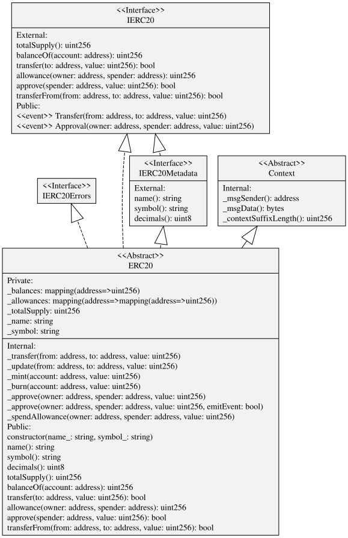
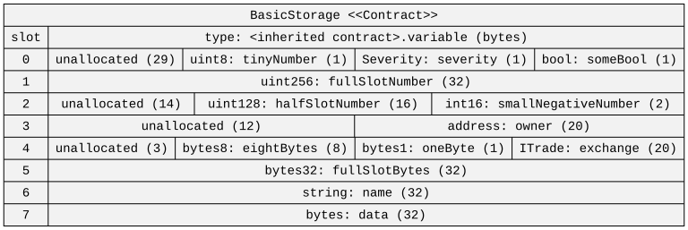
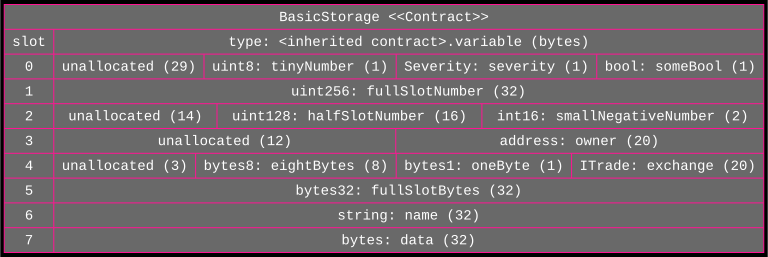

# sol2uml-light

sol2uml-light is a standalone Solidity visualization CLI. The [Solidity Agent Toolkit repository](https://github.com/whackur/solidity-agent-toolkit) also ships it as a separately tracked package copy. This package generates UML class and storage-layout diagrams from Solidity sources, flattens verified contracts, and compares contract source. It is a Node.js 24+ CommonJS package. SVG is the default output; PNG rendering uses [@resvg/resvg-js](https://github.com/thx/resvg-js) without installing or launching a browser.

Forked from [naddison36/sol2uml](https://github.com/naddison36/sol2uml) at commit [`38090363ccc0220376a87bff8ac0964f6616d8f6`](https://github.com/naddison36/sol2uml/tree/38090363ccc0220376a87bff8ac0964f6616d8f6) by importing an archive; the import did not include upstream Git history. The upstream MIT license and copyright notice are preserved in [LICENSE](./LICENSE).

## Current examples

The [example gallery](./examples/README.md) leads with diagrams generated offline from the checked-in Solidity fixtures and the exact package versions installed by this repository. Regenerate them with `pnpm run examples:build`; the command builds the CLI and runs [`scripts/generate-examples.cjs`](./scripts/generate-examples.cjs). The generator checks the installed package versions and expected class names before it exits successfully.

Current OpenZeppelin diagrams use the stable [5.6.1 release](https://github.com/OpenZeppelin/openzeppelin-contracts/tree/v5.6.1/contracts). The ERC20 example is shown below; the gallery also includes ERC721, AccessControl, ERC-4626, and ERC-4337 examples.



The storage gallery includes regenerated local contract layouts, the file-level storage fixture, and inheritance fixtures. Historical explorer and RPC snapshots remain in the archive sections with their source addresses; they are not regenerated as current examples.

## Install and run

The package requires [Node.js](https://nodejs.org/en/download/) 24 or newer. Install the CLI globally with [pnpm](https://pnpm.io/) 12:

```bash
pnpm add --global sol2uml-light
sol2uml-light --help
```

If pnpm reports `ERR_PNPM_GLOBAL_BIN_DIR_NOT_IN_PATH`, run `pnpm setup` and restart the shell so pnpm can add its global binary directory to `PATH`.

To run the CLI once without a global install:

```bash
pnpm dlx --package=sol2uml-light sol2uml-light --help
```

To build and run the CLI from this checkout:

```bash
pnpm install --frozen-lockfile
pnpm run build
node lib/sol2uml.js --help
```

The `src/contracts` examples below use fixtures from this repository checkout. From its root after building the source CLI, run:

```bash
node lib/sol2uml.js class ./src/contracts -o contracts.svg
node lib/sol2uml.js storage ./src/contracts -c BasicStorage -o BasicStorage.svg
```

SVG is the default output format. Add `-f png` for PNG or `-f all` to write DOT, SVG, and PNG files. See the [examples](./examples/README.md), or run `sol2uml-light <command> --help` for current options.

## Main commands

```text
sol2uml-light class <file-or-folder>       Generate a UML class diagram.
sol2uml-light storage <file-or-folder>     Generate a storage-layout diagram.
sol2uml-light flatten <contract-address>   Flatten verified source from an explorer.
sol2uml-light diff <address-a> <source-b>  Compare verified source to a contract or local files.
```

Explorer and RPC features require the appropriate explorer API key or node URL. Local examples and `pnpm run examples:build` do not contact a blockchain service.

## UML class diagram syntax

Useful resources for learning UML include [UML 2 Class Diagramming Guidelines](http://www.agilemodeling.com/style/classDiagram.htm) and [Creating class diagrams with UML](https://www.ionos.com/digitalguide/websites/web-development/class-diagrams-in-uml/).

### Terminology and stereotypes

A Solidity variable becomes an attribute in UML, and a Solidity function becomes an operation.

Class stereotypes:

- `Interface`
- `Abstract` when a contract has abstract functions. Child contracts that do not implement all abstract functions are not currently marked as abstract.
- `Library`

Operator stereotypes:

- `event`
- `modifier`
- `abstract` when a contract function has no body. Interface operators do not get this stereotype because all interface operators are abstract.
- `fallback` for an abstract fallback function; payable fallback functions use the `payable` stereotype.

### UML associations

- Solid lines show storage-type dependencies, contract and abstract-contract inheritance, and contract-level struct or enum aggregation.
- Dashed lines show interface inheritance and memory-variable dependencies.
- Empty triangle heads show contract, interface, and abstract-contract inheritance.
- Open arrow heads show storage or memory dependencies.
- Diamond tails show contract-level struct and enum aggregation.

## Storage diagrams



See [storage examples](./examples/storage/README.md) for current local diagrams and archived on-chain snapshots.

The storage command derives layouts from Solidity's parsed AST and does not invoke `solc`, so its results can differ from compiler layouts. Fixed-size array dimensions support integer literals and resolvable constant names; arithmetic expressions in dimensions are unsupported.

## Styling colors

The `backColor`, `shapeColor`, `fillColor`, and `textColor` options customize diagram colors. Named colors use the [X11 color scheme](https://graphviz.org/doc/info/colors.html#x11); RGB values such as `#ffffff` and `#000000` are also supported. See the [Graphviz color reference](https://graphviz.org/docs/attr-types/color/).

From the repository root after building the source CLI, regenerate the checked-in storage fixture with custom colors:

```bash
node lib/sol2uml.js storage ./src/contracts/storage -c BasicStorage -sc deeppink -tc '#ffffff' -fc dimgrey -bc black -o examples/storage/BasicStorageColor.svg
```



## Version 2.x changes

The 2.x release introduced subcommands and contract storage diagrams. See [version 2.x changes](./version2.md) for changes from 1.x.

## Contribution

Maintainers can create patch, minor, and major releases with `pnpm release patch|minor|major`; see the [release guide](./RELEASE.md) for preconditions, npm trusted publishing setup, and recovery steps.

The maintained source is grouped into AST/import handling, storage layout and RPC values, explorer/filesystem access, CLI commands, domain models, diagrams, and diff reporting. Existing top-level and deep module paths remain compatibility facades, including `lib/diff`.

Development tooling and the CLI runtime require Node.js 24 or newer. TypeScript stays on 6.0 for compatibility with the current test and lint peers. Commander stays on 12 to preserve documented multi-character short flags. OpenZeppelin examples and fixtures use the stable 5.6.1 release; the checked-in Account Abstraction diagrams use contracts 0.8.0.

Solidity 0.8 fixtures and inline test sources use the exact `pragma solidity 0.8.38;` declaration. Older fixture families remain for legacy source parsing, and Explorer integration tests retain the compiler versions of their actual deployed contracts.

The supported offline workflows use the pinned JavaScript compiler and repository tooling: `pnpm run test:solidity`, `pnpm run test:libraries`, and `pnpm run examples:build`. They do not download a compiler or contact a remote service. `src/contracts/libraries/BigInt.sol` uses the exact `pragma solidity 0.8.38;` declaration.

The target-aware compiler compatibility suite compiles the `tests/contracts/modern` fixtures and `src/contracts/libraries/BigInt.sol` for Osaka and experimental Amsterdam, with optimization enabled and both `viaIR` settings, then checks compiler metadata and AST/UML diagram output. These checks cover compilation and source parsing, not runtime deployment behavior. Amsterdam requires the compiler's `settings.experimental` option.

The `solc` development dependency is pinned for a reproducible compiler/target matrix, and the pnpm workspace override keeps its temporary-file dependency on patched `tmp` 0.2.7. The legacy `pnpm run buildSol` helper invokes a separately installed native `solc` against mixed historical fixtures; use it only when that native compiler matrix is installed.

Run only the Solidity 0.8.38 target matrix with:

```bash
pnpm run test:solidity
```

Build the TypeScript files and run the offline Jest tests with:

```bash
pnpm run build
pnpm run test
```

Run the separate Explorer/RPC suites with `pnpm run test:integration` and the required `SCAN_API_KEY` and `NODE_URL` credentials. These network suites are not part of the default offline test run.

To rebuild the checked-in current examples and verify them against the installed stable package versions:

```bash
pnpm run examples:build
```

The parser-library-only assertions in `solidity-parser.test.ts` were removed; `astConversion.test.ts` and `fileParser.test.ts` cover the toolkit's parsing behavior. The assertion-free empty-SVG case in `converter.test.ts` was removed; `writerFiles.test.ts` covers output writing and failure behavior.

## About

This is a rewrite of Richard Ramos's [solidity-diagram-gen](https://github.com/richard-ramos/solidity-diagram-gen), which no longer works with newer Solidity syntax such as `constructor`.

sol2uml-light uses [@solidity-parser/parser](https://github.com/solidity-parser/parser), maintained by the Solidity tool community led by Franco Victorio (@fvictorio). It is a fork of Federico Bond's [solidity-parser-antlr](https://github.com/federicobond/solidity-parser-antlr). The DOT generation logic and UML syntax have been rewritten.

The [Solidity language grammar](https://docs.soliditylang.org/en/latest/grammar.html) is published with each major release. The diagrams use [viz.js](https://github.com/mdaines/viz.js/) and [Graphviz](https://graphviz.org/) to render SVG; [Graphviz Online](https://dreampuf.github.io/GraphvizOnline/) can render DOT source.

The `diff` command uses Google's [Diff Match and Patch](https://github.com/google/diff-match-patch) library.
