# Account Abstraction 0.8.0

These current diagrams use the stable [`@account-abstraction/contracts` 0.8.0 package](https://www.npmjs.com/package/@account-abstraction/contracts/v/0.8.0) and the installed OpenZeppelin Contracts 5.6.1 dependency. Source links are pinned to the [`v0.8.0` release](https://github.com/eth-infinitism/account-abstraction/tree/v0.8.0): [`IAccount.sol`](https://github.com/eth-infinitism/account-abstraction/blob/v0.8.0/contracts/interfaces/IAccount.sol), [`SimpleAccount.sol`](https://github.com/eth-infinitism/account-abstraction/blob/v0.8.0/contracts/accounts/SimpleAccount.sol), and [`EntryPoint.sol`](https://github.com/eth-infinitism/account-abstraction/blob/v0.8.0/contracts/core/EntryPoint.sol).

The diagrams are generated offline from the installed package and current OpenZeppelin sources. From the repository root, regenerate the complete set with:

```bash
pnpm run examples:build
```

For one diagram, run the following from the repository root. The first commands install dependencies and build the checkout CLI; subsequent commands invoke it directly with `node lib/sol2uml.js`. Keep the shell open for the remaining snippets, which reuse the exported `AA` source roots:

```bash
pnpm install --frozen-lockfile
pnpm run build
AA_PACKAGE="$(node -p "require('node:fs').realpathSync('node_modules/@account-abstraction/contracts')")"
OZ_PACKAGE="$(node -p "require('node:fs').realpathSync('node_modules/@openzeppelin/contracts')")"
export AA="$AA_PACKAGE,$OZ_PACKAGE"
node lib/sol2uml.js class "$AA" --baseContractNames SimpleAccount --hideFilename --outputFileName examples/accountAbstraction/SimpleAccountLinked.svg
```

## IAccount

```bash
node lib/sol2uml.js class "$AA" --baseContractNames IAccount --hideFilename --outputFileName examples/accountAbstraction/IAccount.svg
```

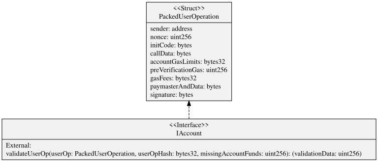

## SimpleAccount diagrams

| View                    | Options                                                     |
| ----------------------- | ----------------------------------------------------------- |
| Hierarchy               | `--hideFunctions --hideVariables --hideEnums --hideStructs` |
| Squashed public members | `--squash --depth 0 --hidePrivates`                         |
| Squashed all members    | `--squash --depth 0`                                        |
| Base only               | `--depth 0`                                                 |
| Depth 1                 | `--depth 1`                                                 |
| All linked contracts    | no additional options                                       |

```bash
node lib/sol2uml.js class "$AA" --baseContractNames SimpleAccount --hideFunctions --hideVariables --hideEnums --hideStructs --hideFilename --outputFileName examples/accountAbstraction/SimpleAccountHierarchy.svg
node lib/sol2uml.js class "$AA" --baseContractNames SimpleAccount --squash --depth 0 --hidePrivates --hideFilename --outputFileName examples/accountAbstraction/SimpleAccountSquashedPub.svg
node lib/sol2uml.js class "$AA" --baseContractNames SimpleAccount --squash --depth 0 --hideFilename --outputFileName examples/accountAbstraction/SimpleAccountSquashed.svg
node lib/sol2uml.js class "$AA" --baseContractNames SimpleAccount --depth 0 --hideFilename --outputFileName examples/accountAbstraction/SimpleAccountDepth0.svg
node lib/sol2uml.js class "$AA" --baseContractNames SimpleAccount --depth 1 --hideFilename --outputFileName examples/accountAbstraction/SimpleAccountDepth1.svg
node lib/sol2uml.js class "$AA" --baseContractNames SimpleAccount --hideFilename --outputFileName examples/accountAbstraction/SimpleAccountLinked.svg
```

| Hierarchy                                                | Squashed public                                                  | Squashed all                                           |
| -------------------------------------------------------- | ---------------------------------------------------------------- | ------------------------------------------------------ |
| 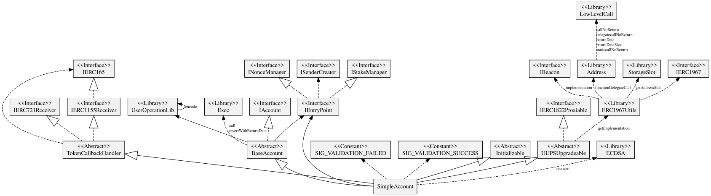 | 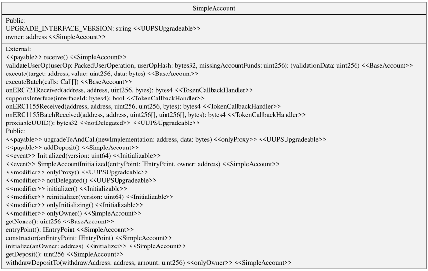 | 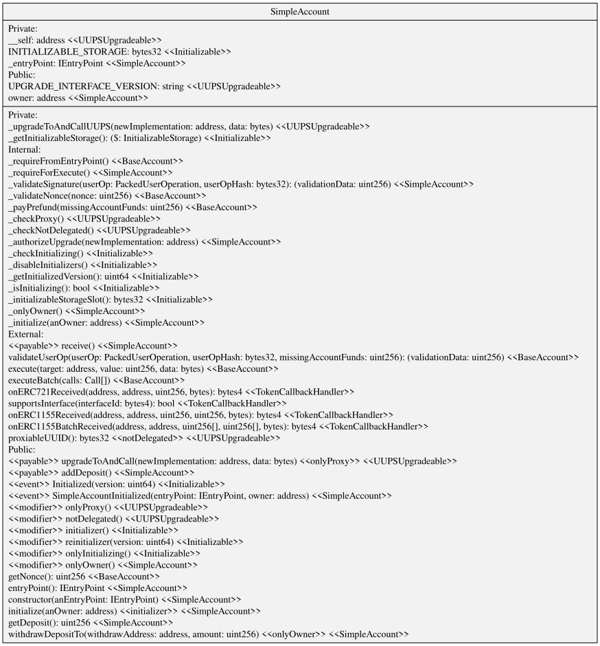 |

| Base only                                           | Depth 1                                             | All linked                                         |
| --------------------------------------------------- | --------------------------------------------------- | -------------------------------------------------- |
| 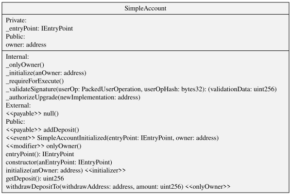 | 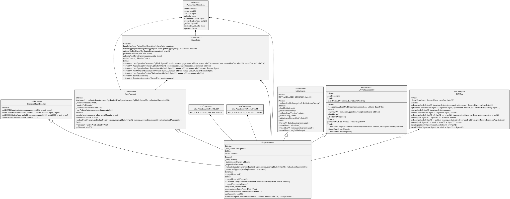 | 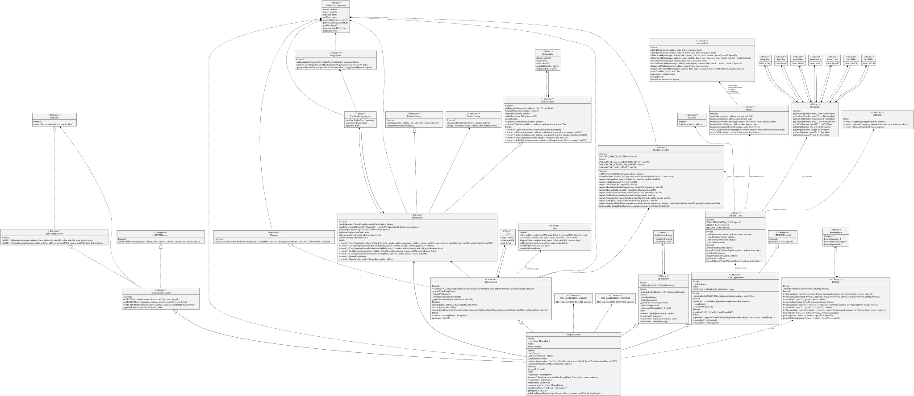 |

## EntryPoint diagrams

```bash
node lib/sol2uml.js class "$AA" --baseContractNames EntryPoint --hideFunctions --hideVariables --hideEnums --hideStructs --hideFilename --outputFileName examples/accountAbstraction/EntryPointHierarchy.svg
node lib/sol2uml.js class "$AA" --baseContractNames EntryPoint --squash --hideSourceContract --hidePrivates --depth 0 --hideFilename --outputFileName examples/accountAbstraction/EntryPointSquashedPub.svg
node lib/sol2uml.js class "$AA" --baseContractNames EntryPoint --squash --hideSourceContract --depth 0 --hideFilename --outputFileName examples/accountAbstraction/EntryPointSquashedAll.svg
node lib/sol2uml.js class "$AA" --baseContractNames EntryPoint --squash --depth 0 --hideFilename --outputFileName examples/accountAbstraction/EntryPointSquashedInherit.svg
node lib/sol2uml.js class "$AA" --baseContractNames EntryPoint --squash --depth 1 --hideFilename --outputFileName examples/accountAbstraction/EntryPointSquashedDepth1.svg
node lib/sol2uml.js class "$AA" --baseContractNames EntryPoint --depth 1 --hideFilename --outputFileName examples/accountAbstraction/EntryPointLinked.svg
node lib/sol2uml.js class "$AA" --baseContractNames EntryPoint --hideFilename --outputFileName examples/accountAbstraction/EntryPointLinkedAll.svg
```

| Hierarchy                                          | Squashed public                                            | Squashed all                                            | Squashed inherited                                                |
| -------------------------------------------------- | ---------------------------------------------------------- | ------------------------------------------------------- | ----------------------------------------------------------------- |
| 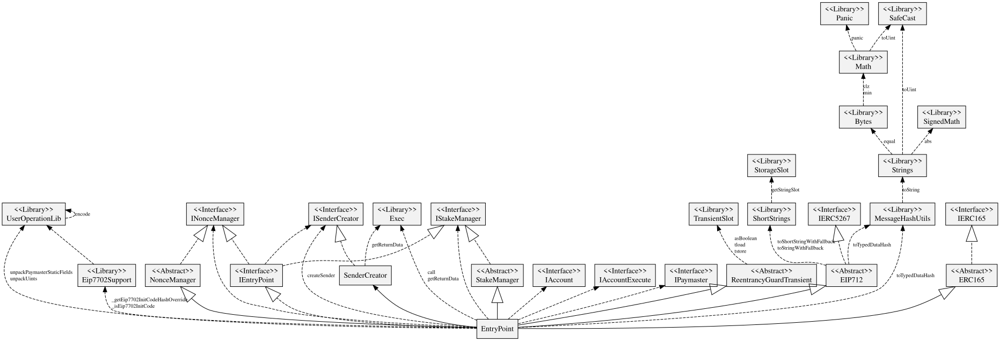 | 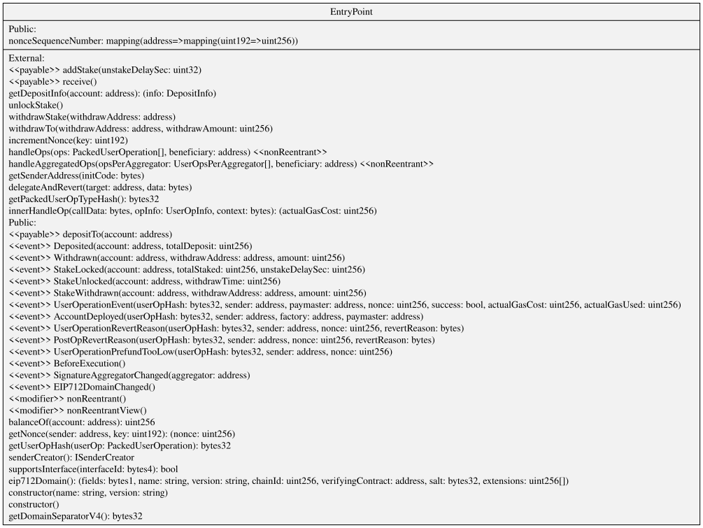 | 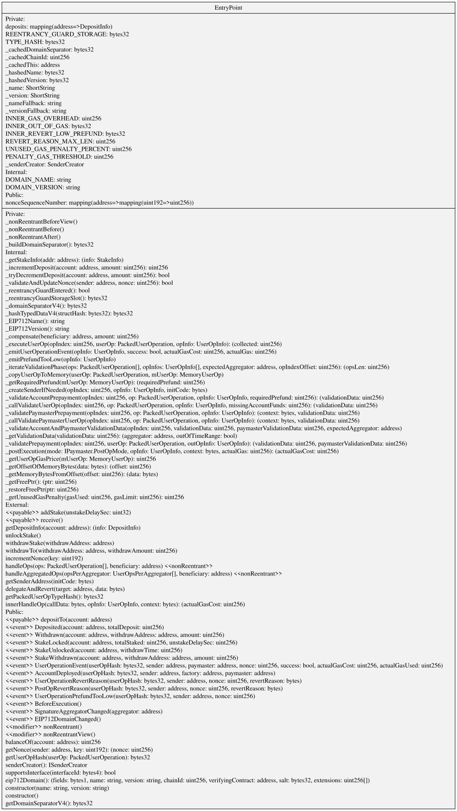 | 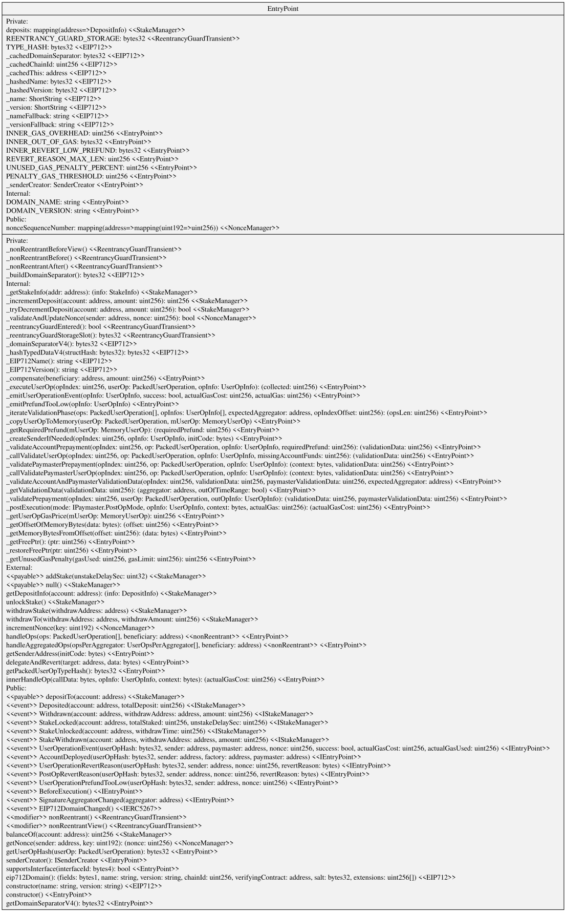 |

| Squashed depth 1                                               | Linked depth 1                                       | All linked                                          |
| -------------------------------------------------------------- | ---------------------------------------------------- | --------------------------------------------------- |
| 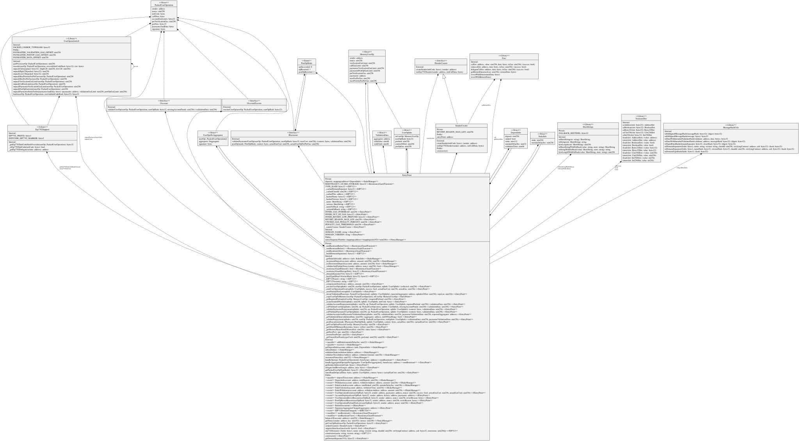 | 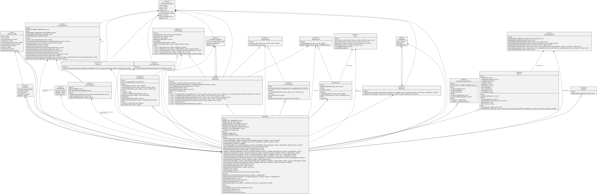 | 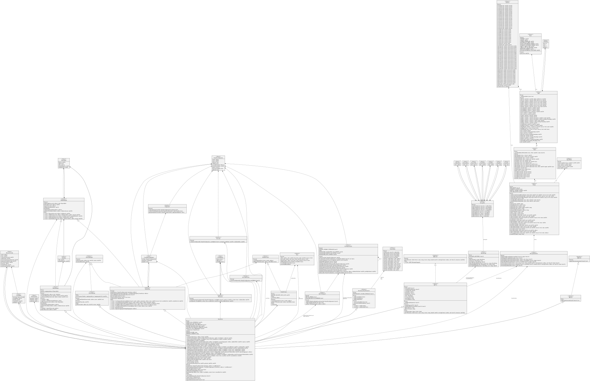 |

## Structs and all production contracts

The first diagram hides contracts, interfaces, libraries, and enums to focus on the package structs. The second excludes sample and test folders.

```bash
node lib/sol2uml.js class "$AA" --hideLibraries --hideInterfaces --hideEnums --hideContracts --hideFilename --outputFileName examples/accountAbstraction/AAStructs.svg
node lib/sol2uml.js class "$AA" --ignoreFilesOrFolders samples,test --hideFilename --outputFileName examples/accountAbstraction/all.svg
```

| Struct types                                    | Production contracts                        |
| ----------------------------------------------- | ------------------------------------------- |
| 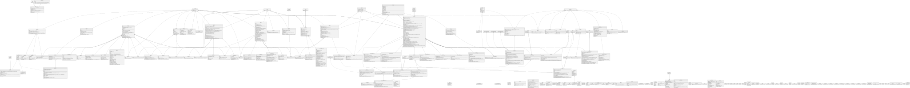 |  |
