# Storage diagrams

## Current local diagrams

The local diagrams below are generated from source files in this repository that declare Solidity 0.8.38. They describe source-code layout and do not fetch contract state. Rebuild the current set with `pnpm run examples:build`.

| Contract                         | Diagram                                                                                |
| -------------------------------- | -------------------------------------------------------------------------------------- |
| `BasicStorage`                   | 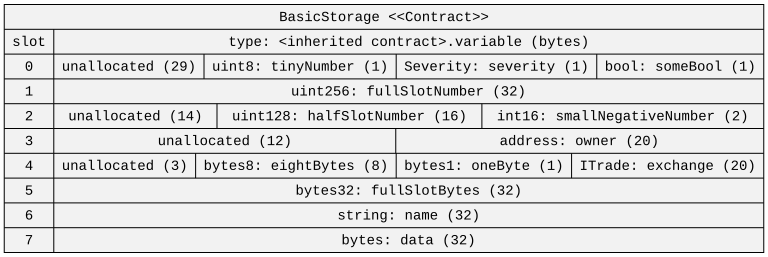                                                    |
| `BasicStorage` with colors       | 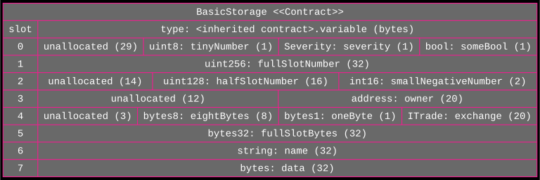                                 |
| `DynamicArrayStorage`            | 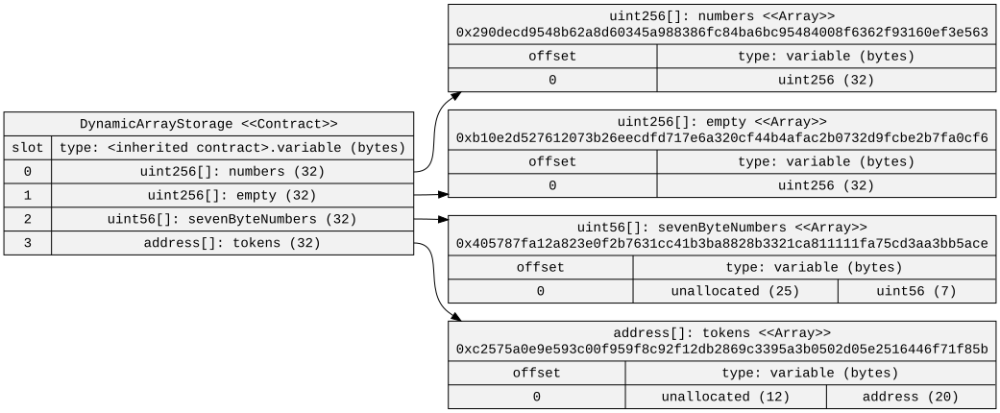                                      |
| `FixedArrayStorage`              | 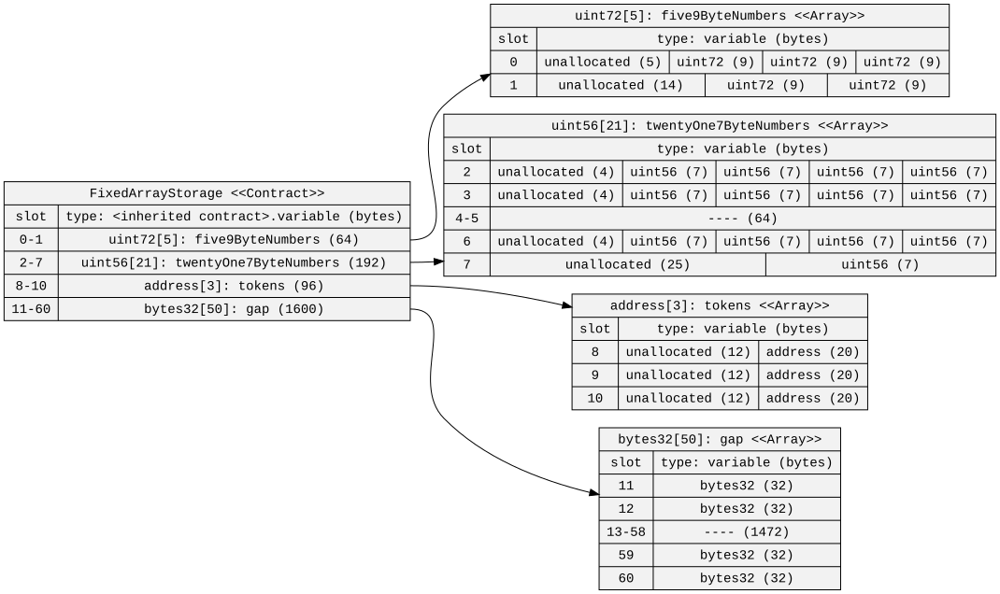                                          |
| `MappingStorage`                 | 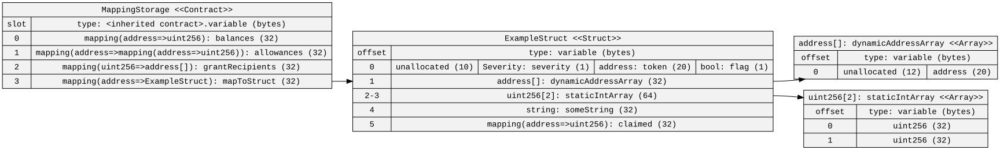                                                |
| `MultiDynamicArrayStorage`       | 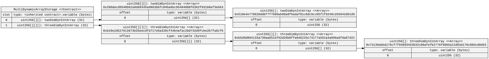                            |
| `MultiFixedArrayStorage`         | 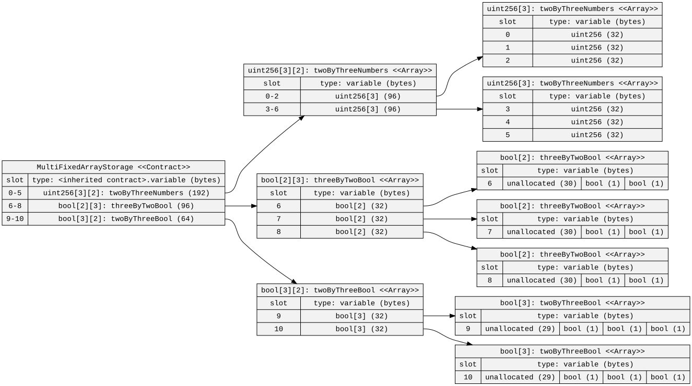                                |
| `StringStorage`                  | 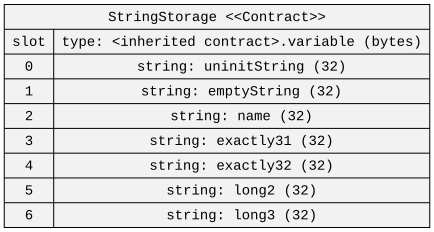                                                  |
| `StructStorage`                  | 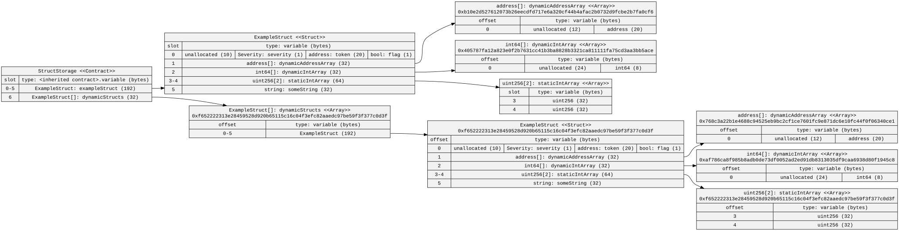                                                  |
| `TestStorage`                    | 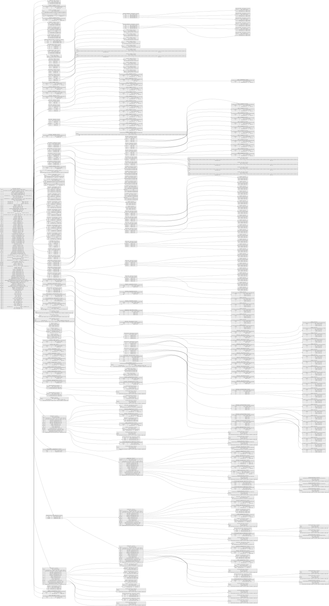                                                      |
| `TestContract` file-level layout | 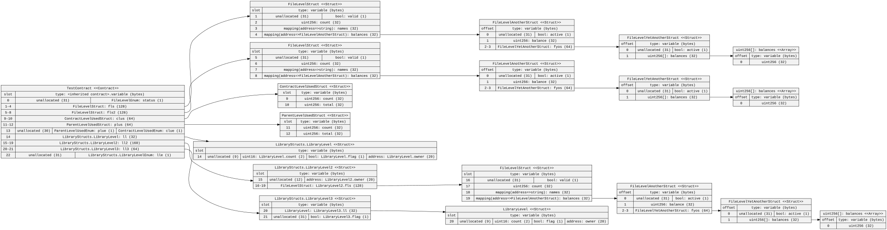 ([PNG](./FileLevel-storage.png)) |
| Inheritance contract `D`         | 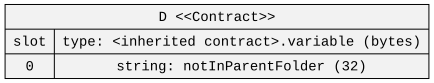                                       |

To run individual source commands, install dependencies and build the CLI from the repository root:

```bash
pnpm install --frozen-lockfile
pnpm run build
```

Generate one local layout from the repository root with the built CLI:

```bash
node lib/sol2uml.js storage ./src/contracts/storage -c BasicStorage -o examples/storage/BasicStorage.svg
```

For a class diagram of inherited contracts, run `node lib/sol2uml.js class ./src/contracts/inheritance --clusterFolders -o examples/inheritanceDiamond.svg`.

## Reading a storage diagram

Each storage slot is 32 bytes. Solidity packs adjacent values into the same slot when their combined size fits; the diagram lists packed fields from right to left and marks unused bytes as `unallocated`. A value wider than 16 bytes generally takes its own slot, while smaller values can share one.

Fixed-size arrays place their items consecutively in storage, packing items when their widths permit it. Dynamic arrays store their length in the declared slot; item data starts at `keccak256(slot)`. Multi-dimensional arrays apply the same rules recursively. The diagram can show the slot formula from source without reading any on-chain value.

Struct diagrams expand the struct fields and show how many slots the struct occupies. Mappings do not store a value at their declared slot; the mapped value location is derived from the key and declaration slot. Since the key space cannot be enumerated from source, mapping values are not listed unless they are read from a known key by other means.

Short strings are stored inline in their slot. Strings longer than 31 bytes store their encoded length in the declared slot and place the UTF-8 bytes at the hash-derived location. The source-only diagram can show the storage structure; the value view needs a node URL.

Inheritance diagrams include storage from base contracts and display the resulting layout for the selected derived contract. See `D` in the table above for a local diamond-inheritance example.

## File-level storage layout

These diagrams are generated from [`FileLevel.sol`](../../src/contracts/fileLevel/FileLevel.sol), including its file-level, library, and inherited contract types. Regenerate them with `pnpm run examples:build`.


The PNG rendering is also available as [FileLevel-storage.png](./FileLevel-storage.png).

## Archived on-chain snapshots

These files preserve diagrams generated from historical explorer sources and node state. They are archived examples, not current gallery outputs; `pnpm run examples:build` does not regenerate them. Each address below records the source used for the imported snapshot. It does not imply that the source is currently verified, that the node state was revalidated, or that a fresh request would return the same values.

| Diagram                                | Historical source                                                                                                                                                                                                                                  |
| -------------------------------------- | -------------------------------------------------------------------------------------------------------------------------------------------------------------------------------------------------------------------------------------------------- |
| `BasicStorageData.svg`                 | Arbitrum, [contract `0x8e2587…7cb960`](https://arbiscan.io/address/0x8e2587265c68cd9ee3ecbf22dc229980b47cb960#code)                                                                                                                                |
| `FixedArrayStorageData.svg`            | Arbitrum, [contract `0x796c00…913c85`](https://arbiscan.io/address/0x796c008d8addcc33da3e946ca457432a35913c85#code)                                                                                                                                |
| `MultiFixedArrayStorageData.svg`       | Arbitrum, [contract `0xe147cb…41c3ea`](https://arbiscan.io/address/0xe147cb7d90b9253844130e2c4a7ef0ffb641c3ea#code)                                                                                                                                |
| `DynamicArrayStorageData.svg`          | Arbitrum, [contract `0x665353…87f80b`](https://arbiscan.io/address/0x66535378de7fb9219b637dbe3e3ffad33387f80b#code)                                                                                                                                |
| `MultiDynamicArrayStorageData.svg`     | Arbitrum, [contract `0x6f44d1…82e027`](https://arbiscan.io/address/0x6f44d1108bb79710c1bbe378661d90876682e027#code)                                                                                                                                |
| `StructStorageData.svg`                | Arbitrum, [contract `0xb8f98c…5cffe2`](https://arbiscan.io/address/0xb8f98c34e40e0d201ce2f3440ce92d0b5c5cffe2#code)                                                                                                                                |
| `StringStorageData.svg`                | Arbitrum, [contract `0xef2a93…bd9861`](https://arbiscan.io/address/0xef2a93be2bed1b577d460c347f82de1ba8bd9861#code)                                                                                                                                |
| `origin-oeth-dripper.svg` and variants | Ethereum implementation [`0x2fdfbb…e43dec`](https://etherscan.io/address/0x2fdfbb2b905484f1445e23a97c97f65fe0e43dec#code), with proxy storage [`0xc0f42f…317eb3`](https://etherscan.io/address/0xc0f42f73b8f01849a2dd99753524d4ba14317eb3#code)    |
| `usdcData.svg`                         | Ethereum USDC implementation [`0xa2327a…cbdcf`](https://etherscan.io/address/0xa2327a938febf5fec13bacfb16ae10ecbc4cbdcf#code), with proxy storage [`0xa0b869…6eb48`](https://etherscan.io/address/0xa0b86991c6218b36c1d19d4a2e9eb0ce3606eb48#code) |
| `StakedTokenBPTData.svg`               | Ethereum, [source `0xc63a48…3e4193`](https://etherscan.io/address/0xc63a48d85cce7c3bd4d18db9c0972a4d223e4193#code), storage [`0xefbe22…7b011`](https://etherscan.io/address/0xefbe22085d9f29863cfb77eed16d3cc0d927b011#code), block 16,000,000     |
| `UniswapV3PoolData.svg`                | Ethereum, [pool `0x8ad599…6e6d8`](https://etherscan.io/address/0x8ad599c3a0ff1de082011efddc58f1908eb6e6d8#code)                                                                                                                                    |
| `EmissionsControllerData.svg`          | Ethereum, [source `0xebfd9c…f27a83`](https://etherscan.io/address/0xebfd9cd78510c591eda8735d0f8a87414ef27a83#code), storage [`0xba69e6…d91780`](https://etherscan.io/address/0xba69e6fc7df49a3b75b565068fb91ff2d9d91780#code)                      |
| `EmissionsController.svg`              | Ethereum, [source `0xebfd9c…f27a83`](https://etherscan.io/address/0xebfd9cd78510c591eda8735d0f8a87414ef27a83#code)                                                                                                                                 |
| `AaveV3PoolStorageColor.svg`           | Ethereum, [Aave V3 Pool `0xfcc00a…21585`](https://etherscan.io/address/0xfcc00a1e250644d89af0df661bc6f04891e21585#code)                                                                                                                            |
| `StakedTokenBPT.png`                   | Same Ethereum source and storage addresses as `StakedTokenBPTData.svg`                                                                                                                                                                             |
| `usdc.png`                             | Same Ethereum implementation and proxy addresses as `usdcData.svg`                                                                                                                                                                                 |

One historical data diagram can be regenerated from a configured Ethereum node with `NODE_URL`:

```bash
NODE_URL=https://your-node-url node lib/sol2uml.js storage -d -s 0xA0b86991c6218b36c1d19D4a2e9Eb0cE3606eB48 0xa2327a938febf5fec13bacfb16ae10ecbc4cbdcf -o usdcData.svg
```

The `-d, --data` option reads storage values, `-s, --storage` selects the address whose state is read when source and proxy addresses differ, and `-bn, --block` selects a block. A live query requires a compatible RPC endpoint and can return values different from these archived snapshots. Other imported storage artifacts not listed above remain unindexed legacy files because the imported archive did not retain their source address.
